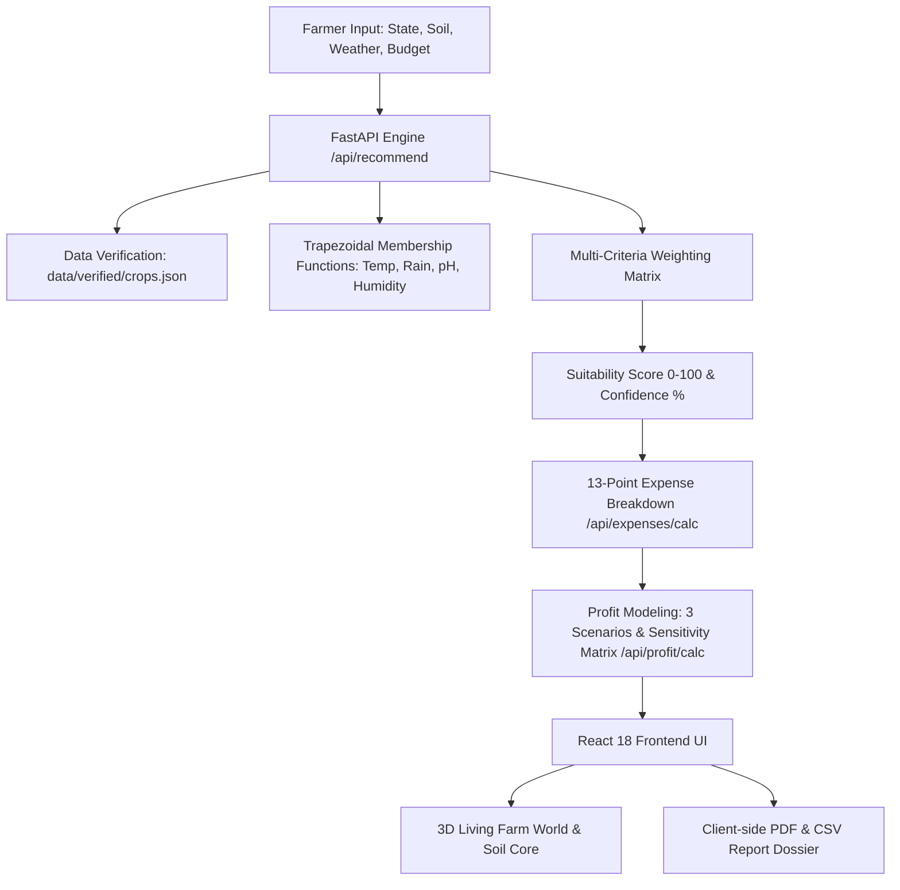

# AgriSmart Ultra: System Architecture & Data Flow

## 1. Overview
AgriSmart Ultra is a full-stack agronomic decision support and profit intelligence platform built to eliminate guessing in Indian crop selection.

## 2. Recommendation Engine Mechanics
- **Trapezoidal Membership**: Continuous evaluation between absolute biological minimums and optimal plateau ranges.
- **Factor Weights**:
  - Soil Match: 25%
  - Temperature Fit: 20%
  - Rainfall & Water Adequacy: 20%
  - Soil pH Tolerance: 12%
  - Cropping Season Window: 10%
  - Relative Humidity Fit: 8%
  - Budget Tolerance: 5%

## 3. Financial Formulas
- `Total Expected Yield = Area × Yield per unit`
- `Saleable Yield = Total Yield × (1 - post-harvest loss %)`
- `Gross Revenue = Saleable Yield × Price`
- `Net Profit = Gross Revenue - Total Cost`
- `Break-even Yield per acre = Total Cost ÷ (Price × (1 - loss%) × Area)`
- `Break-even Price = Total Cost ÷ Expected Saleable Yield`

## 4. Security & Isolation
- Supabase Row Level Security (RLS) policies enforce that users access only their own farm profiles, recommendations, and saved plans.
- Anonymous / demo users run in safe local-first storage mode with zero credential requirements.
